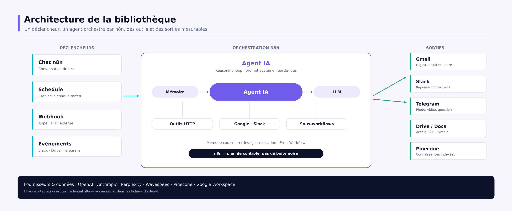

# 🔗 AI Workflow Automation (n8n)

**Une bibliothèque de 16 workflows n8n prêts à importer** : agents IA, génération d'images et de vidéos, orchestration de sous-workflows, RAG avec Pinecone, MCP et équipe marketing multi-agents.

[](https://n8n.io)
[](workflows/README.md)
[](catalog.json)
[](LICENSE)
[](docs/AI-Workflow-Automation-n8n-Guide.pdf)



---

## Sommaire

- [En 30 secondes](#en-30-secondes)
- [Les 10 modules](#les-10-modules)
- [Démarrage rapide](#démarrage-rapide)
- [Configuration](#configuration)
- [Structure du dépôt](#structure-du-dépôt)
- [Qualité et CI](#qualité-et-ci)
- [Sécurité](#sécurité)
- [Documentation](#documentation)
- [Limites connues](#limites-connues)
- [Contribuer](#contribuer)
- [Licence](#licence)

---

## En 30 secondes

Ce dépôt est un **parcours pratique**, pas une collection de fichiers isolés :

- 🎓 **Progressif** : du premier agent e-mail au système multi-agents de production.
- 🧱 **Réutilisable** : des sous-workflows appelés comme des fonctions.
- 🔐 **Sain** : credentials gérés par n8n, `.env` ignoré, validateur de secrets.
- 📚 **Documenté** : un README par module, un guide PDF et une présentation.
- ✅ **Vérifié** : 16 workflows, 112 nœuds, connexions et absence de secrets contrôlées en CI.

| Indicateur | Valeur |
| --- | --- |
| Modules | **10** |
| Workflows | **16** |
| Nœuds | **112** |
| Secrets dans le dépôt | **0** |

---

## Les 10 modules

Chaque module possède son dossier, ses workflows et sa fiche : `workflows/<module>/README.md`.

| # | Module | Niveau | Durée | Ce que vous construisez |
| --- | --- | --- | --- | --- |
| 01 | [Email AI Agent](workflows/01-email-agent/README.md) | Débutant | 30 min | Un agent qui rédige et envoie un e-mail |
| 02 | [Daily AI News Digest](workflows/02-research-agent/README.md) | Intermédiaire | 45 min | Une veille quotidienne Perplexity → GPT → Gmail |
| 03 | [Text-to-Image Studio](workflows/03-text-to-image/README.md) | Intermédiaire | 45 min | Génération d'images avec polling et retry |
| 04 | [Text-to-Video Studio](workflows/04-text-to-video/README.md) | Intermédiaire | 45 min | Génération vidéo Veo 3 |
| 05 | [Orchestration & Subworkflows](workflows/05-subworkflows/README.md) | Avancé | 1 h | Drive → Telegram → Sheets → sous-workflow vidéo |
| 06 | [Slack AI Teammate](workflows/06-slack-agent/README.md) | Intermédiaire | 45 min | Un coéquipier IA dans Slack |
| 07 | [RAG avec Pinecone](workflows/07-rag-pinecone/README.md) | Avancé | 1 h 30 | Ingestion documentaire + agent support |
| 08 | [MCP Lab](workflows/08-mcp/README.md) | Avancé | 1 h | Serveur et client MCP dans n8n |
| 09 | [Marketing Team](workflows/09-marketing-team/README.md) | Expert | 2 h | Orchestrateur + 4 sous-agents spécialisés |
| 10 | [Ops & Error Handling](workflows/10-production/README.md) | Avancé | 30 min | Workflow d'erreur global et alerte Slack |

📖 Catalogue complet, prérequis et matrice de credentials : **[docs/WORKFLOWS.md](docs/WORKFLOWS.md)**.

---

## Démarrage rapide

### Prérequis

- **Docker** (recommandé) ou **Node.js ≥ 24** pour l'exécution locale ;
- une instance n8n 2.x (fournie par Docker Compose ou `npm start`) ;
- les comptes des fournisseurs utilisés par le module choisi (OpenAI, Gmail, etc.).

### Option A — Docker (recommandé)

```bash
git clone https://github.com/<votre-compte>/ai-automation-n8n.git
cd ai-automation-n8n

cp .env.example .env
docker compose up -d
# → http://localhost:5678
```

Importez ensuite les workflows, soit depuis l'interface (**Workflows → Import from File**), soit en ligne de commande :

```bash
docker compose exec n8n n8n import:workflow \
  --input=/workflows/01-email-agent/email-agent.json
```

Le dossier `workflows/` est monté en lecture seule dans le conteneur : `/workflows`.

### Option B — npm (développement local)

```bash
npm install          # installe n8n 2.47.3
npm start            # http://localhost:5678
```

Dans un second terminal :

```bash
npm run import       # importe les 16 workflows
```

### Après l'import

1. **Credentials** : n8n → *Credentials → Create credential* (voir le tableau du module).
2. **Sélection** : ouvrez chaque workflow et choisissez les credentials sur les nœuds concernés.
3. **Variables** : renseignez `TELEGRAM_CHAT_ID` dans `.env` pour le module 05.
4. **Sous-workflows** : reliez les modules 05 et 09 avec une clé API n8n :

```bash
N8N_URL=http://localhost:5678 N8N_API_KEY=... python3 scripts/link_subworkflows.py
```

> La clé se crée dans n8n → *Settings → n8n API*. Sans elle, les nœuds *Execute Workflow* restent à sélectionner manuellement.

### Vérifier le dépôt

```bash
python3 scripts/validate_workflows.py   # ou : npm test
```

---

## Configuration

### Credentials n8n

| Type | Utilisé par | Modules |
| --- | --- | --- |
| `openAiApi` | Agents, prompts, embeddings | 01, 02, 03, 04, 05, 06, 07, 08, 09 |
| `gmailOAuth2` | Envoi d'e-mails, outil Gmail | 01, 02, 03, 04, 08 |
| `perplexityApi` | Recherche web | 02, 09 |
| `httpHeaderAuth` | Clé Wavespeed | 03, 04, 05, 09 |
| `googleDriveOAuth2Api` | Déclencheur fichiers | 05, 07 |
| `googleSheetsOAuth2Api` | Journalisation | 05 |
| `telegramApi` | Notifications et questions | 05 |
| `slackApi` | Trigger et réponses Slack | 06, 10 |
| `googleDocsOAuth2Api` | Base de connaissances, publication | 06, 09 |
| `pineconeApi` | Index vectoriel | 07, 09 |
| `anthropicApi` | Rédaction longue | 09 |

Aucune valeur de credential n'est présente dans le dépôt : seuls les **noms de types** sont documentés.

### Variables d'environnement

| Variable | Rôle |
| --- | --- |
| `TELEGRAM_CHAT_ID` | Chat cible du module 05, injecté via `{{ $env.TELEGRAM_CHAT_ID }}` |
| `N8N_ENCRYPTION_KEY` | **À sauvegarder** : sans elle, les credentials chiffrés sont illisibles |
| `GENERIC_TIMEZONE` | Fuseau des Schedule Triggers (défaut `Europe/Paris`) |
| `N8N_WEBHOOK_URL` | URL publique de l'instance pour les webhooks |

Copiez `.env.example` vers `.env`. Le fichier `.env` est ignoré par Git.

---

## Structure du dépôt

```text
.
├── catalog.json                  # source de vérité : modules, workflows, credentials
├── workflows/
│   ├── README.md                 # index de la bibliothèque (généré)
│   ├── 01-email-agent/
│   │   ├── email-agent.json
│   │   └── README.md             # fiche du module (générée)
│   ├── 02-research-agent/
│   ├── 03-text-to-image/
│   ├── 04-text-to-video/
│   ├── 05-subworkflows/
│   ├── 06-slack-agent/
│   ├── 07-rag-pinecone/          # + data/airnova-sop.txt
│   ├── 08-mcp/
│   ├── 09-marketing-team/
│   └── 10-production/
├── docs/
│   ├── GUIDE.md                  # guide complet (généré)
│   ├── WORKFLOWS.md              # catalogue détaillé (généré)
│   ├── AI-Workflow-Automation-n8n-Guide.pdf
│   ├── AI-Workflow-Automation-n8n-Presentation.pptx
│   └── assets/                   # schémas PNG (générés)
├── scripts/
│   ├── validate_workflows.py     # qualité + sécurité
│   ├── build_catalog.py          # catalogue et README de modules
│   ├── make_diagrams.py          # schémas PNG
│   ├── generate_docs.py          # GUIDE.md + PDF + PowerPoint
│   ├── import_workflows.sh       # import CLI
│   ├── link_subworkflows.py      # reconnexion des sous-workflows
│   ├── sanitize_workflows.py     # migration des exports d'origine
│   └── package.py                # archive distribuable
├── docker-compose.yml
├── Makefile
└── .github/workflows/ci.yml
```

Chaque workflow JSON est un export n8n standard, importable via l'interface ou la CLI.

---

## Qualité et CI

```bash
make validate   # JSON, nœuds, connexions, secrets, cohérence du catalogue
make test       # validate + vérification que le catalogue est à jour
make docs       # schémas + GUIDE.md + PDF + PowerPoint
```

Le validateur contrôle notamment :

- la validité JSON et la structure minimale d'un workflow n8n ;
- l'unicité des noms de nœuds et l'intégrité de toutes les connexions ;
- l'absence de `credentials`, `pinData`, identifiants d'instance et secrets ;
- l'absence d'adresses e-mail codées en dur autres que les placeholders ;
- la cohérence entre `catalog.json`, les fichiers et les README générés ;
- l'existence, dans `.env.example`, des variables `$env.*` utilisées.

La CI GitHub Actions exécute ces contrôles et construit le PDF et le PowerPoint à chaque push.

---

## Sécurité

- ❌ **Jamais** de clé API, mot de passe ou token dans un fichier de workflow.
- ✅ Les secrets vivent dans les **credentials n8n** ou dans `.env` (non versionné).
- ✅ Les exports ont été nettoyés : `pinData`, identifiants d'instance, IDs Drive/Sheets/Docs/Pinecone et chat Telegram personnels supprimés.
- ✅ Les webhooks publics doivent être protégés (authentification, allowlist, rate limit).
- ✅ Sauvegardez `N8N_ENCRYPTION_KEY` : elle chiffre les credentials stockés.
- ✅ Activez le workflow d'erreur global (module 10) sur les workflows critiques.

En cas de fuite suspectée : révoquez la clé chez le fournisseur, recréez le credential dans n8n et vérifiez les exécutions récentes.

---

## Documentation

| Document | Description |
| --- | --- |
| 📕 [Guide PDF](docs/AI-Workflow-Automation-n8n-Guide.pdf) | 15 chapitres : architecture, modules, sécurité, coûts, limites, annexes |
| 📊 [Présentation PowerPoint](docs/AI-Workflow-Automation-n8n-Presentation.pptx) | 17 slides pour présenter le dépôt en 10 minutes |
| 📘 [Guide Markdown](docs/GUIDE.md) | Version texte du guide |
| 📗 [Catalogue](docs/WORKFLOWS.md) | Workflows, déclencheurs, credentials, variables |
| 🧩 [catalog.json](catalog.json) | Données structurées, utilisées par les générateurs |

Toute la documentation est régénérable : `make docs`.

---

## Limites connues

- Les boucles de polling des modules 03, 04 et 09 **n'ont pas de compteur maximal** : ajoutez une condition d'arrêt avant la production.
- Les nœuds *Execute Workflow* / *toolWorkflow* doivent être reliés après import (`link_subworkflows.py`).
- Aucun credential n'est fourni : les workflows ne s'exécutent pas sans vos comptes.
- La CI ne réalise pas d'appels payants : les tests de bout en bout restent manuels.
- L'URL MCP dépend de votre hébergement : copiez-la depuis le nœud *MCP Server Trigger*.
- Une instance unique est configurée par défaut ; le queue mode n'est pas inclus.

---

## Contribuer

1. Un module = un dossier dans `workflows/`, un export JSON, une entrée dans `catalog.json`.
2. Aucun secret, aucune donnée personnelle, aucun `pinData` dans les exports.
3. `make test` doit passer ; `make catalog` régénère les README.
4. Mettez à jour les textes dans `scripts/content.py` puis `make docs` pour le PDF et le PowerPoint.

---

## Licence

[MIT](LICENSE) © 2026 Alex Alkhatib

Les workflows s'appuient sur n8n et sur les API d'OpenAI, Anthropic, Perplexity, Wavespeed, Pinecone, Google Workspace, Slack et Telegram. Chaque fournisseur applique ses propres conditions.

---

<p align="center">
  <strong>Prêt à automatiser ?</strong><br/>
  Commencez par le module 01, puis ajoutez les briques une par une.
</p>
