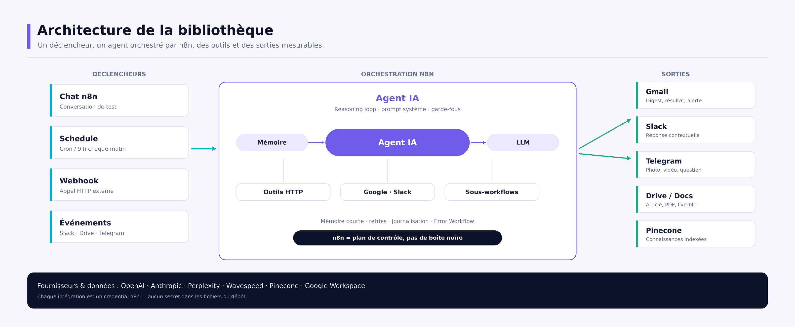
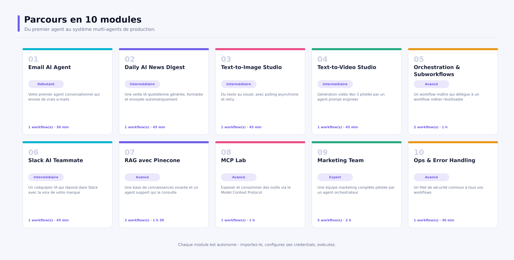
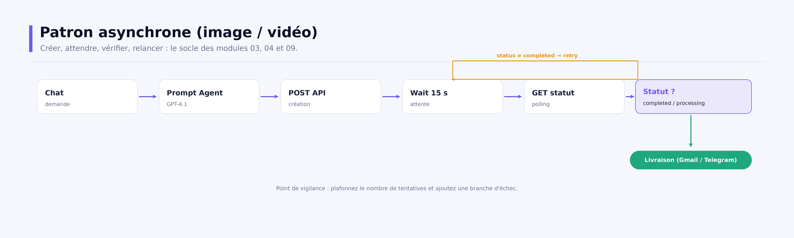
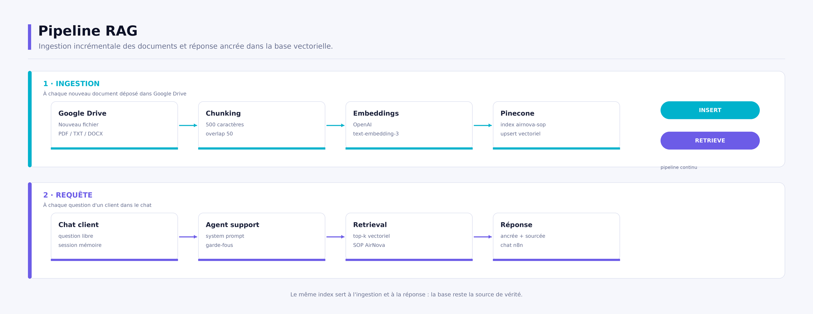

# AI Workflow Automation avec n8n

*Guide technique et pédagogique — agents IA, RAG, MCP et automatisations prêtes pour la production*

**Version 2.0.0** · 10 novembre 2026 · Alex Alkhatib · Licence MIT

> Document généré automatiquement depuis [`scripts/content.py`](../scripts/content.py). Modifiez le contenu source puis lancez `make docs`.

## Sommaire

- [01 · Résumé exécutif](#r-sum-ex-cutif)
- [02 · Contexte et objectifs](#contexte-et-objectifs)
- [03 · Architecture de la bibliothèque](#architecture-de-la-biblioth-que)
- [04 · Parcours pédagogique](#parcours-p-dagogique)
- [05 · Fondations : un agent, des outils](#fondations-un-agent-des-outils)
- [06 · Médias génératifs : le patron asynchrone](#m-dias-g-n-ratifs-le-patron-asynchrone)
- [07 · Orchestration et sous-workflows](#orchestration-et-sous-workflows)
- [08 · RAG, MCP et connaissance](#rag-mcp-et-connaissance)
- [09 · Système multi-agents marketing](#syst-me-multi-agents-marketing)
- [10 · Sécurité, coûts et production](#s-curit-co-ts-et-production)
- [11 · Mise en route](#mise-en-route)
- [12 · Qualité, limites et feuille de route](#qualit-limites-et-feuille-de-route)
- [A · Annexe A — Catalogue des workflows](#annexe-a-catalogue-des-workflows)
- [B · Annexe B — Credentials et variables](#annexe-b-credentials-et-variables)
- [C · Annexe C — Licence et crédits](#annexe-c-licence-et-cr-dits)

---

## 01 · Résumé exécutif

*VUE D'ENSEMBLE*

Ce dépôt rassemble **16 workflows n8n prêts à importer**, organisés en **10 modules progressifs** : agents conversationnels, génération d'images et de vidéos, orchestration de sous-workflows, RAG avec Pinecone, MCP et équipe marketing multi-agents.

La version 2 est une refonte complète : arborescence normalisée, exports nettoyés des identifiants d'instance et des données de test, documentation générée, contrôle qualité automatisé et script de reconnexion des sous-workflows. L'objectif est simple : qu'un lecteur puisse cloner le dépôt, importer un module et comprendre ce qu'il exécute en moins de trente minutes.

| Indicateur | Valeur | Précision |
| --- | --- | --- |
| modules | 10 | du débutant à l'expert |
| workflows | 16 | prêts à importer |
| nœuds | 112 | orchestration documentée |
| secret | 0 | dans le dépôt |

### Ce que la v2 apporte

- **Structure lisible** : un dossier par module, un README par module, un catalogue généré.
- **Sécurité** : aucun secret, aucune adresse personnelle, aucun identifiant de ressource privée.
- **Qualité** : validateur JSON et connexions, CI GitHub Actions, catalogue vérifié.
- **Documentation** : README, guide PDF, présentation PowerPoint et schémas d'architecture.
- **Exploitabilité** : Docker Compose, import en ligne de commande, workflow d'erreur global.

> **La promesse** — Chaque module est autonome. Vous pouvez commencer par l'agent e-mail, puis ajouter le RAG et l'orchestration sans réécrire ce qui fonctionne.


---

## 02 · Contexte et objectifs

*POURQUOI CE DÉPÔT*

L'automatisation par workflow répond à un problème concret : les tâches répétitives consomment du temps, les intégrations se multiplient et les équipes passent plus de temps à recâbler des scripts qu'à concevoir des processus. n8n apporte un plan de contrôle visuel, auto-hébergeable, capable d'appeler des API, des modèles de langage et des bases vectorielles.

### À qui s'adresse la bibliothèque

- **Développeurs et architectes** qui veulent un exemple complet d'orchestration IA.
- **Équipes data et ops** qui industrialisent des traitements documentaires.
- **Consultants et formateurs** qui cherchent un support de cours progressif.
- **Curieux techniques** à l'aise avec les API, les webhooks et les credentials.

### Compétences visées

| Compétence | Modules |
| --- | --- |
| Concevoir un agent avec outils et mémoire | 01, 02, 06 |
| Piloter une API asynchrone et du polling | 03, 04, 09 |
| Découper un processus en sous-workflows | 05, 09 |
| Construire une base de connaissances vectorielle | 07 |
| Exposer et consommer des outils MCP | 08 |
| Superviser, sécuriser et diagnostiquer | 10 |

> **Prérequis** — Une instance n8n (Docker ou npm), des comptes chez les fournisseurs utilisés et un minimum de familiarité avec les API HTTP. Aucun secret n'est fourni : chaque module liste les credentials à créer.


---

## 03 · Architecture de la bibliothèque

*COMMENT C'EST CONSTRUIT*

n8n joue le rôle de plan de contrôle : il déclenche, séquence, réessaie et journalise. Le raisonnement est délégué aux modèles, les actions aux outils, et la connaissance aux bases vectorielles. Cette séparation permet de remplacer un fournisseur sans réécrire le processus métier.



*Figure 1 — Déclencheurs, orchestration, outils et sorties.*

### Les sept briques à connaître

| Brique | Rôle | Exemple dans le dépôt |
| --- | --- | --- |
| Trigger | Démarre le workflow | Chat, Schedule 9 h, Drive, Slack |
| Agent | Boucle raisonnement / action | Email AI Agent, RAG Support Agent |
| Outil | Action exposée au modèle | Gmail, Google Docs, recherche Perplexity |
| Mémoire | Contexte de conversation | Simple Memory par canal ou session |
| Sous-workflow | Workflow appelé comme fonction | Modules 05 et 09 |
| Credential | Secret géré par n8n | OAuth2 Google, clés API, header auth |
| Error Workflow | Filet de sécurité global | Module 10 |

> **Règle d'architecture** — Un workflow = une responsabilité. Dès qu'un enchaînement devient long ou réutilisable, extrayez-le en sous-workflow et exposez-le comme outil.


---

## 04 · Parcours pédagogique

*DIX MODULES*

La progression suit une logique d'usage : d'abord un agent minimal, puis la planification et la recherche, ensuite les médias asynchrones, l'orchestration, la connaissance, et enfin les systèmes multi-agents et la supervision. Suivez l'ordre des numéros : chaque module réutilise les briques introduites par les précédents.



*Figure 2 — Les dix modules et leurs niveaux.*

### Vue synthétique

| # | Module | Niveau | Durée | Workflows | Nœuds |
| --- | --- | --- | --- | --- | --- |
| 01 | Email AI Agent | Débutant | 30 min | 1 | 6 |
| 02 | Daily AI News Digest | Intermédiaire | 45 min | 1 | 6 |
| 03 | Text-to-Image Studio | Intermédiaire | 45 min | 1 | 8 |
| 04 | Text-to-Video Studio | Intermédiaire | 45 min | 1 | 8 |
| 05 | Orchestration & Subworkflows | Avancé | 1 h | 2 | 14 |
| 06 | Slack AI Teammate | Intermédiaire | 45 min | 1 | 6 |
| 07 | RAG avec Pinecone | Avancé | 1 h 30 | 2 | 13 |
| 08 | MCP Lab | Avancé | 1 h | 1 | 7 |
| 09 | Marketing Team | Expert | 2 h | 5 | 40 |
| 10 | Ops & Error Handling | Avancé | 30 min | 1 | 4 |


---

## 05 · Fondations : un agent, des outils

*MODULES 01, 02 ET 06*

Un agent n8n n'est pas un chatbot magique : c'est un modèle de langage entouré d'un prompt système, d'une mémoire et d'outils. Le déclencheur fournit l'intention, l'agent décide de l'action, l'outil exécute, la mémoire conserve le contexte.

### Le patron commun

- **Trigger** : chat, événement Slack ou planification.
- **Modèle** : GPT-4.1 mini pour la vitesse, GPT-5 ou Claude pour la rédaction longue.
- **Mémoire** : fenêtre glissante, indexée par canal ou session.
- **Outils** : Gmail, Google Docs, recherche Perplexity, base vectorielle.
- **Sortie** : réponse, e-mail ou livrable.

### Trois variantes utiles

| Module | Idée | Point pédagogique |
| --- | --- | --- |
| 01 · Email AI Agent | L'agent rédige et envoie un e-mail | Un outil peut être une action métier complète |
| 02 · Daily AI News Digest | Perplexity cherche, GPT met en forme, Gmail envoie | Séparer recherche et présentation améliore la qualité |
| 06 · Slack AI Teammate | Un agent répond dans un canal avec une personnalité | La mémoire par canal évite les mélanges de contexte |

> **Bonne pratique** — Décrivez explicitement le rôle, les contraintes et le format de sortie dans le prompt système. Les prompts fournis sont volontairement stricts : c'est ce qui rend la sortie exploitable par une machine.


---

## 06 · Médias génératifs : le patron asynchrone

*MODULES 03 ET 04*

Les modèles d'image et de vidéo ne répondent pas en quelques centaines de millisecondes. Le workflow adopte donc un cycle en quatre temps : créer la prédiction, attendre, interroger le statut, livrer ou réessayer.



*Figure 3 — Créer, attendre, vérifier, livrer.*

1. Un agent transforme la demande en prompt technique, sans métadonnées parasites.
2. Le nœud HTTP POST envoie la prédiction à Wavespeed (Seedream pour l'image, Veo 3 pour la vidéo).
3. Le nœud Wait suspend l'exécution quinze secondes, sans consommer de ressources.
4. Le nœud HTTP GET lit le statut ; la branche positive livre le média, la branche négative relance l'attente.

> **Limite connue** — La boucle de retry n'a pas de compteur maximal. En production, ajoutez un compteur, une condition d'arrêt et une sortie d'erreur avant de laisser tourner le workflow sans surveillance.

### Choisir le bon modèle

| Besoin | Modèle du dépôt | Remarque |
| --- | --- | --- |
| Visuel rapide | Seedream v3 (1024×1322) | Idéal pour des tests de prompts |
| Vidéo courte | Veo 3 / Veo 3 Fast | Rendu plus long, coût plus élevé |
| Image vers vidéo | Seedance v1 lite | Utilisé par le module 05 |


---

## 07 · Orchestration et sous-workflows

*MODULE 05*

Le module 05 est le patron d'architecture à retenir : un workflow principal détecte un fichier, notifie, journalise, puis délègue la génération vidéo à un workflow séparé. Le sous-workflow reçoit des entrées typées et renvoie un résultat exploitable.

```text
Google Drive (nouveau fichier)
   → Telegram (photo + lien)
   → Google Sheets (journalisation)
   → Execute Workflow (Image URL, Date)
        → Agent prompt vidéo (Seedance)
        → Wait 15 s → GET statut → Completed ?
        → Telegram (vidéo)
        → retour au workflow principal
```

### Pourquoi découper

- **Réutilisation** : le même sous-workflow sert à plusieurs points d'entrée.
- **Lisibilité** : chaque workflow tient sur un écran.
- **Testabilité** : on exécute le sous-workflow seul avec des entrées contrôlées.
- **Évolution** : on change un fournisseur sans toucher à l'orchestrateur.

> **Après import** — n8n réattribue les identifiants des workflows. Les nœuds Execute Workflow sont donc livrés sans cible : lancez scripts/link_subworkflows.py avec une clé API pour les relier automatiquement par nom.

### Contrat d'interface du sous-workflow

| Entrée | Type | Usage |
| --- | --- | --- |
| Image URL | string | Image source envoyée au modèle vidéo |
| Date | string ISO | Horodatage journalisé avec le résultat |


---

## 08 · RAG, MCP et connaissance

*MODULES 07 ET 08*

Un agent sans connaissance répond avec des généralités. Le module 07 construit une base vectorielle à partir de documents métier, puis expose cette base comme outil de retrieval. Le module 08 va plus loin : il standardise les outils via le Model Context Protocol.



*Figure 4 — Ingestion documentaire et réponse ancrée.*

### Les étapes du pipeline

| Étape | Décision | Réglage du dépôt |
| --- | --- | --- |
| Découpage | Taille des chunks | 500 caractères, overlap 50 |
| Embeddings | Modèle vectoriel | OpenAI text-embedding-3 |
| Indexation | Base et index | Pinecone, index airnova-sop |
| Retrieval | Mode d'exposition | retrieve-as-tool, top-k par défaut |
| Génération | Modèle de réponse | GPT-4.1 mini, prompt support |

### MCP en pratique

- Le **MCP Server Trigger** publie un outil n8n derrière un endpoint standard.
- Le **MCP Client Tool** permet à un agent de consommer ce serveur, local ou distant.
- Le même catalogue d'outils peut servir à plusieurs agents et à d'autres clients MCP.
- L'URL dépend de votre hébergement : copiez-la depuis le nœud, ne la devinez pas.

> **Qualité documentaire** — Un RAG ne vaut que par ses sources. Versionnez les documents, surveillez les documents obsolètes et testez régulièrement des questions dont vous connaissez la réponse attendue.


---

## 09 · Système multi-agents marketing

*MODULE 09*

Le module 09 assemble un orchestrateur et quatre sous-agents spécialisés. L'orchestrateur comprend la demande, choisit l'outil adapté, transmet uniquement l'idée utile, puis restitue le livrable. C'est un exemple complet de division du travail entre modèles.

### Rôles de l'équipe

| Agent | Spécialité | Sortie |
| --- | --- | --- |
| Marketing Team Master | Comprend la demande et délègue | Contenu final |
| Create_Image | Prompt visuel et génération | Image |
| Create_Video | Prompt vidéo et génération | Vidéo |
| Caption_Writer_Agent | Déclinaisons LinkedIn / X / Instagram | Captions |
| Blogpost_Copywriter | Article long structuré | Google Doc |

### Règles de conception

- **Une entrée par outil** : ne transmettez que l'idée, pas tout le contexte.
- **Descriptions explicites** : le modèle choisit l'outil sur la description.
- **Modèles adaptés** : GPT-5 pour l'orchestration, Claude pour la rédaction longue.
- **Sortie contrôlée** : les sous-agents produisent un format stable, pas du bavardage.
- **Coût** : chaque appel d'outil consomme des tokens ; mesurez avant d'élargir.

> **Point d'attention** — L'orchestrateur n'a pas de sortie branchée par défaut : choisissez le canal de livraison (Slack, Gmail, Drive) et testez d'abord chaque sous-agent isolément.


---

## 10 · Sécurité, coûts et production

*CE QUI FAIT LA DIFFÉRENCE*

Un workflow de démonstration devient un incident de production dès qu'il manipule des données réelles. Les contrôles ci-dessous sont appliqués dans le dépôt ou documentés pour l'exploitation.

### Contrôles de sécurité

| Risque | Contrôle | Où |
| --- | --- | --- |
| Secret dans un export | Credentials n8n, .env ignoré, validateur dédié | Dépôt + CI |
| Données personnelles | pinData supprimé, identifiants neutralisés | Workflows |
| Webhook public | Authentification, allowlist, rate limit | Instance n8n |
| Injection de prompt | Garde-fous, validation de sortie, outils restreints | Agents |
| Fuite de contexte | Minimisation des données envoyées aux modèles | Prompts |
| Perte de chiffrement | Sauvegarde de N8N_ENCRYPTION_KEY | Infrastructure |
| Erreur silencieuse | Error Workflow global + alerte Slack | Module 10 |
| Coûts incontrôlés | Quotas fournisseurs et alertes budgétaires | Comptes |

### Ordres de grandeur des coûts

| Fournisseur | Usage | Coût relatif | Optimisation |
| --- | --- | --- | --- |
| OpenAI | Agents, prompts, embeddings | €€ | Modèles mini, cache, batch |
| Anthropic | Rédaction longue | €€ | Sonnet plutôt qu'Opus |
| Perplexity | Recherche web | €€ | Une requête par jour |
| Wavespeed | Image et vidéo | €€€ | Valider les prompts avant génération |
| Pinecone | Base vectorielle | € | Un index, nettoyage régulier |
| n8n | Orchestration | € | Auto-hébergement Docker |

> **À retenir** — Consultez les grilles tarifaires à jour : les coûts évoluent vite. En revanche, la règle ne change pas — aucun secret dans un fichier de workflow, aucune clé dans un dépôt Git.


---

## 11 · Mise en route

*DE ZÉRO À PREMIER WORKFLOW*

Deux chemins équivalents : Docker Compose pour une instance isolée, ou npm pour développer avec les outils locaux. Dans les deux cas, commencez par le module 01, puis ajoutez les briques une par une.

```bash
# 1. Configuration
cp .env.example .env
docker compose up -d          # http://localhost:5678

# 2. Import (interface ou CLI)
bash scripts/import_workflows.sh

# 3. Credentials : OpenAI, Gmail, etc. puis sélection dans les nœuds
# 4. Relier les sous-workflows (clé API n8n requise)
N8N_URL=http://localhost:5678 N8N_API_KEY=... \
  python3 scripts/link_subworkflows.py

# 5. Vérifier le dépôt
python3 scripts/validate_workflows.py
```

1. Créez les credentials dans n8n → Credentials, jamais dans le fichier JSON.
2. Ouvrez le workflow importé, sélectionnez les credentials sur chaque nœud.
3. Renseignez TELEGRAM_CHAT_ID dans .env pour le module 05.
4. Testez en mode manuel, puis activez le workflow.

### Commandes utiles

| Commande | Effet |
| --- | --- |
| make start | Démarre n8n en local |
| make import | Importe les 16 workflows |
| make validate | Valide JSON, connexions et secrets |
| make catalog | Régénère catalogue et README de modules |
| make docs | Régénère schémas, PDF et PowerPoint |
| make zip | Produit l'archive distribuable |


---

## 12 · Qualité, limites et feuille de route

*TRANSPARENCE*

### Contrôles automatisés

| Contrôle | Outil | Déclencheur |
| --- | --- | --- |
| JSON, nœuds, connexions, secrets | scripts/validate_workflows.py | Commit et CI |
| Catalogue et README à jour | scripts/build_catalog.py --check | CI |
| PDF et PowerPoint générés | make docs | CI |
| Import dans n8n | CLI n8n | Avant release |

### Limites assumées

| Limite | Impact | Contournement |
| --- | --- | --- |
| Polling sans plafond (03, 04, 09) | Boucle possible en cas d'échec persistant | Compteur + condition d'arrêt |
| Sous-workflows non reliés à l'import | Nœuds sans cible | link_subworkflows.py |
| Credentials non fournis | Workflows non exécutables tels quels | Annexe B |
| Pas d'appels payants en CI | Pas de test de bout en bout | Tests manuels + pinned data |
| MCP dépend du domaine | URL à adapter | Copier l'URL du nœud |
| Instance unique par défaut | Pas de montée en charge horizontale | Queue mode + Postgres/Redis |

### Feuille de route

- Plafonner les retries et ajouter une branche d'échec explicite.
- Ajouter des jeux de données épinglés pour tester sans appels externes.
- Industrialiser l'observabilité : logs structurés, métriques, alertes.
- Versionner les workflows dans Git via l'API n8n.
- Documenter un déploiement queue mode pour la charge.
- Proposer une version anglaise du guide.

> **Contribution** — Un module = un dossier, un README, des credentials documentés et un export sans secret. Le validateur et la CI vérifient automatiquement ces règles.


---

## A · Annexe A — Catalogue des workflows

*RÉFÉRENCE*

### Workflows livrés

| # | Fichier | Rôle | Déclencheur | Sortie |
| --- | --- | --- | --- | --- |
| 01 | email-agent.json | main | Chat | E-mail Gmail |
| 02 | daily-ai-news-digest.json | main | Schedule (9 h) | E-mail Gmail |
| 03 | text-to-image.json | main | Chat | E-mail avec URL de l'image |
| 04 | text-to-video.json | main | Chat | E-mail avec URL de la vidéo |
| 05 | image-to-video-orchestrator.json | main | Google Drive (nouveau fichier) | Sheet + Telegram + appel de sous-workflow |
| 05 | image-to-video-subworkflow.json | subworkflow | Execute Workflow Trigger | Vidéo Telegram |
| 06 | slack-ai-teammate.json | main | Slack (événement) | Réponse Slack |
| 07 | knowledge-ingestion.json | ingestion | Google Drive (nouveau fichier) | Vecteurs Pinecone |
| 07 | rag-support-agent.json | agent | Chat | Réponse sourcée |
| 08 | mcp-lab.json | main | Chat | E-mail via outil MCP |
| 09 | marketing-team-orchestrator.json | main | Chat | Image, vidéo, blogpost ou captions |
| 09 | text-to-image-subworkflow.json | subworkflow | Execute Workflow Trigger | Visuel généré |
| 09 | text-to-video-subworkflow.json | subworkflow | Execute Workflow Trigger | Vidéo générée |
| 09 | caption-copywriter-subworkflow.json | subworkflow | Execute Workflow Trigger | Captions LinkedIn / X / Instagram |
| 09 | blogpost-copywriter-subworkflow.json | subworkflow | Execute Workflow Trigger | Article Google Docs |
| 10 | error-handler.json | ops | Error Trigger | Alerte Slack |


---

## B · Annexe B — Credentials et variables

*CONFIGURATION*

### Credentials par module

| Module | Types de credentials n8n |
| --- | --- |
| 01 · Email AI Agent | openAiApi, gmailOAuth2 |
| 02 · Daily AI News Digest | perplexityApi, openAiApi, gmailOAuth2 |
| 03 · Text-to-Image Studio | openAiApi, httpHeaderAuth, gmailOAuth2 |
| 04 · Text-to-Video Studio | openAiApi, httpHeaderAuth, gmailOAuth2 |
| 05 · Orchestration & Subworkflows | googleDriveOAuth2Api, googleSheetsOAuth2Api, telegramApi, openAiApi, httpHeaderAuth |
| 06 · Slack AI Teammate | slackApi, openAiApi, googleDocsOAuth2Api |
| 07 · RAG avec Pinecone | pineconeApi, openAiApi, googleDriveOAuth2Api |
| 08 · MCP Lab | openAiApi, gmailOAuth2 |
| 09 · Marketing Team | openAiApi, anthropicApi, perplexityApi, pineconeApi, googleDocsOAuth2Api, httpHeaderAuth |
| 10 · Ops & Error Handling | slackApi |

### Variables d'environnement

| Variable | Module | Rôle |
| --- | --- | --- |
| `TELEGRAM_CHAT_ID` | 05 | Identifiant du chat Telegram cible, injecté via {{ $env.TELEGRAM_CHAT_ID }}. |

> **Bon réflexe** — Créez un credential par environnement (test, production) et nommez-le explicitement. Les exports ne contiennent que le nom du credential, jamais sa valeur.


---

## C · Annexe C — Licence et crédits

*INFORMATIONS LÉGALES*

Le dépôt est distribué sous licence MIT. Vous pouvez l'utiliser, le modifier et le redistribuer, y compris commercialement, à condition de conserver la notice de copyright.

Les workflows s'appuient sur n8n (fair-code, licence Sustainable Use), sur les API d'OpenAI, Anthropic, Perplexity, Wavespeed et Pinecone, ainsi que sur Google Workspace, Slack et Telegram. Chaque fournisseur applique ses propres conditions d'utilisation et sa politique de confidentialité.

Auteur : Alex Alkhatib — ingénieur en intelligence artificielle, automatisation, agents IA et architectures intelligentes.

> **Sources** — Documentation n8n : docs.n8n.io · Documentation Pinecone : docs.pinecone.io · Spécification MCP : modelcontextprotocol.io


---

*AI Workflow Automation (n8n) · version 2.0.0 · 10 novembre 2026 · licence MIT*
